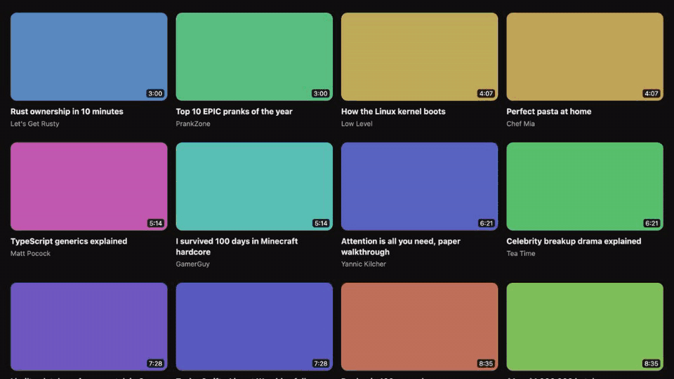
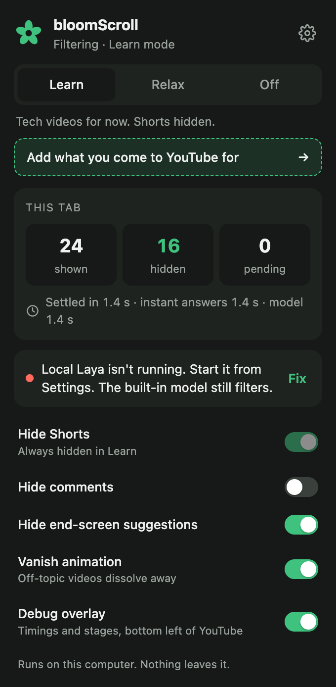
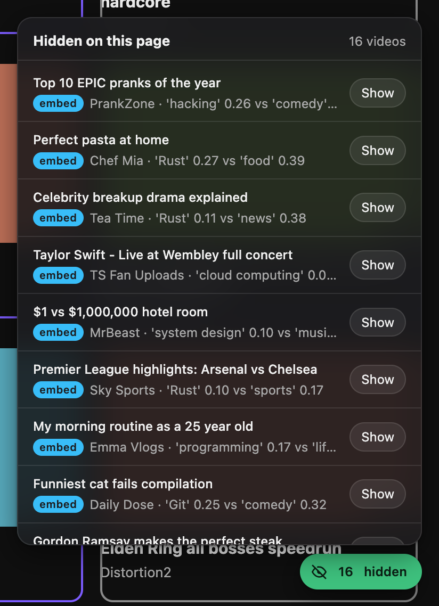
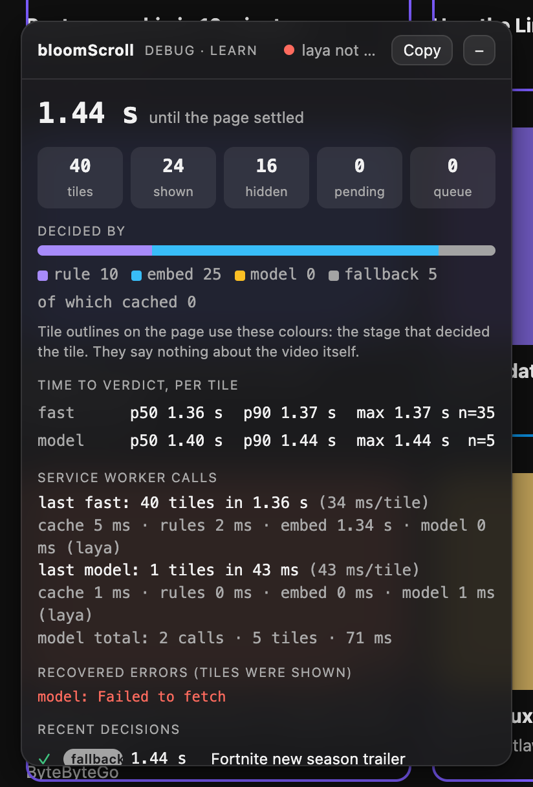
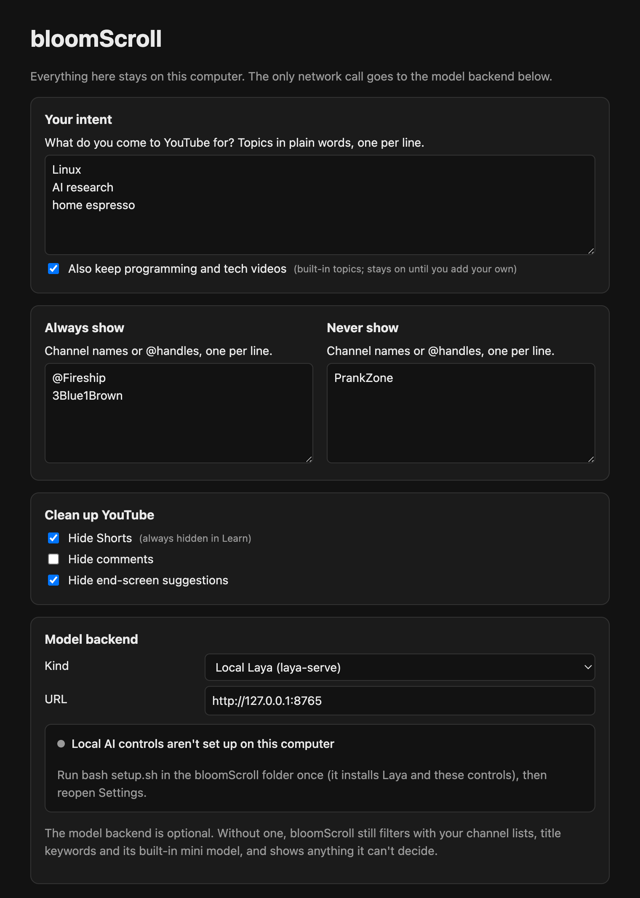

<div align="center">

# bloomScroll

**Keeps YouTube on what you came for.**

A free, open-source browser extension that quietly removes off-topic videos from your YouTube
feed, so the tutorials you wanted stay and the rabbit holes disappear. It runs on your own
computer: no account, no tracking, nothing sent anywhere.

[](https://github.com/rohan2010/bloomScroll/actions/workflows/ci.yml)


</div>

> **Status:** early release, with updates coming soon. It works today on YouTube's home page,
> search results and the "up next" sidebar. bloomScroll is built and tested on a Mac; Windows and
> Linux may work, but haven't been tested yet.

---

## Contents

- [What it does](#what-it-does)
- [See it in action](#see-it-in-action)
- [Get started](#get-started) (pick the easy path if you're new to this)
- [Everyday use](#everyday-use)
- [How it works](#how-it-works)
- [Will it slow down my computer?](#will-it-slow-down-my-computer)
- [What you need](#what-you-need)
- [Troubleshooting](#troubleshooting)
- [Privacy](#privacy)
- [Contributing](#contributing)
- [For developers](#for-developers)

## What it does

You open YouTube to learn something, and the home page offers you pranks, drama and a hundred
other distractions. bloomScroll reads the title and channel of every video on the page and asks
one question: *is this what I came for?*

- **On-topic videos stay.** You tell it your topics in plain words, like "woodworking" or "AI
  research". Until you do, it keeps programming and tech videos.
- **Off-topic videos are removed** with a short dissolve effect, and the gap closes up.
- **You stay in control.** A small "N hidden" button lists everything that was removed and why,
  with one click to bring any video back, and hovering a video gives you a **Hide** button for
  anything that slipped through. Your corrections are remembered.
- **Extra clean-up:** hide Shorts, comments and end-of-video suggestions with a switch each.

It decides on your own computer, using a small AI model that ships inside the extension and,
optionally, a bigger one you run locally. Nothing you watch is sent to any company.

## See it in action

The real extension on a test feed of 40 videos: off-topic ones dissolve, the rest stay.



| Toolbar popup | Hidden drawer | Debug overlay |
| :---: | :---: | :---: |
|  |  |  |
| Pick a mode, see what happened on this tab, flip clean-up switches. The toolbar icon also shows how many videos were hidden. | Everything removed from this page, and why. One click brings a video back. | For the curious: timings and what decided each video. |

*These screenshots come from a test browser without Laya running, which is why the popup's model
row is red. On your computer, Laya starts by itself after setup and the dot is green.*

## Get started

One setup installs **everything**: the extension, its built-in model, and Laya, the local AI that
settles the videos the built-in model isn't sure about. It takes about 15 minutes, mostly
downloading (about 2 GB), and you only do it once. All you need beforehand is a browser and one free
tool; the setup fetches everything else, including the right version of Python if your computer
doesn't have it.

**1. Install Node.js** (a free tool used to build the extension once). Go to
[nodejs.org](https://nodejs.org), download the **LTS** version and install it like any other app.

**2. Get bloomScroll.** Either:
- on this page, click the green **Code** button → **Download ZIP**, then double-click the ZIP to
  unpack it, or
- if you use git: `git clone https://github.com/rohan2010/bloomScroll.git`

**3. Run the setup.** Open the **Terminal** app (on a Mac: press ⌘ Space, type *Terminal*,
press Enter). Type `cd ` (with a space), drag the bloomScroll folder onto the Terminal window,
press Enter, then run:

```bash
bash setup.sh
```

It checks your computer, builds the extension, installs Laya and sets it to **start by itself
whenever you log in**, so there's nothing to remember afterwards. If it needs to download its own
Python, it asks first. When it finishes it prints **Next steps** and *Local AI (Laya): running*.

**4. Add the extension to your browser.**
1. Open Chrome and type `chrome://extensions` in the address bar (in Edge, `edge://extensions`; in
   Brave, `brave://extensions`).
2. Turn on **Developer mode** (switch in the top-right corner).
3. Click **Load unpacked** and choose the `extension/dist` folder inside bloomScroll.
4. Click the puzzle-piece icon in the toolbar and pin **bloomScroll** so it's always visible.

**5. Tell it what you came for.** The Settings page opens by itself. Add your topics, one per line,
and click **Save**.

**6. Open YouTube.** That's it. Off-topic videos start dissolving within a second or two. The
bloomScroll icon shows how many were hidden, and its popup should show a green dot: *Local Laya
connected*.

> **On Windows?** `setup.sh` needs a bash terminal: install [Git for Windows](https://git-scm.com)
> and run it in **Git Bash**, or use WSL. bloomScroll is built and tested on a Mac, so this may or
> may not work yet; if it fails, the by-hand steps under [What you need](#what-you-need) work
> anywhere Node runs. The browser steps are the same.

### Why Laya runs on your computer

**It keeps bloomScroll private and free.** Your watching habits are personal, so the deciding
happens on your own machine: no titles leave it, there's no subscription or API key, and it keeps
working offline. Laya is small enough to run on an ordinary laptop (this was built on a 2017
MacBook Pro), and it's designed for exactly this kind of quick yes-or-no decision. It listens only
on your own computer (`127.0.0.1`), never on your network. Wondering about memory? See
[Will it slow down my computer?](#will-it-slow-down-my-computer)

<details>
<summary><b>Other setup options</b> (a lighter install, no automatic start, adding Laya later)</summary>

| Command | What it does |
| --- | --- |
| `bash setup.sh` | Everything (recommended) |
| `bash setup.sh --no-server` | The extension and built-in model only, about 50 MB. Unclear videos are simply shown. |
| `bash setup.sh --server-only` | Only Laya: add it later, or repair it |
| `bash setup.sh --no-autostart` | Everything, but Laya doesn't start at login; start it yourself with `server/start.sh` |
| `bash setup.sh --remove-autostart` | Stop Laya starting at login (and stop it now) |

</details>

### Optional: Jev (hosted, with your own key)

If you have a [TypeSafe](https://typesafe.ai) API key, you can use their hosted Jev model instead
of Laya: Settings → Model backend → **Jev**, paste the key, **Save**, **Allow**. It's fast, but
unlike everything else here, **video titles and channel names are sent to TypeSafe**. The Settings
page shows a warning while it's selected.

### Updating

Download or `git pull` the new version, run the same `setup.sh` command again (finished steps
are skipped), click the ↻ reload icon on bloomScroll's card in `chrome://extensions`, then
**reload your YouTube tabs**.

## Everyday use

### Modes

Pick one in the toolbar popup.

| Mode | What stays on the page | Shorts |
| --- | --- | --- |
| **Learn** | Your topics (add them in Settings), plus programming and tech unless you switch that off | Hidden |
| **Relax** | Everything except channels you've blocked | Your choice |
| **Off** | Everything. Only the clean-up switches apply | Your choice |

Until you add topics of your own, Learn keeps programming and tech videos, and the popup reminds
you to tell bloomScroll what you come for. A stricter **Work** mode is being reworked and will
return in a later update.

### Settings (⚙ in the popup)



*Captured in a test browser, so the Local AI box asks you to run `setup.sh`. After setup it shows
Local AI (Laya) is running, with Stop / Start and the start-at-login switch.*

- **Your intent:** topics you care about, one per line. Plain words work best ("woodworking",
  "AI research"). Not into tech? Untick **Also keep programming and tech videos** and only your
  own topics stay.
- **Always show / Never show:** channel names or @handles, one per line. These win over everything
  else.
- **Clean up YouTube:** hide Shorts, comments and end-of-video suggestions.
- **Model backend:** leave it on **Local Laya**, which setup installs and starts for you. The
  **Local AI** box there shows whether it's running, with **Stop** / **Start** buttons and a
  **Start automatically when I log in** switch.
- **Calibrate to your taste:** review a few videos and let bloomScroll tune itself (below).
- **Your data:** export the corrections you've made as a CSV, or delete everything.

### When it gets one wrong

- **It hid something you wanted:** click the **N hidden** button at the bottom right of YouTube,
  find the video, click **Show**.
- **It kept something you didn't want:** hover over the video and click the **Hide** button that
  appears at its top-left corner.

Either way, bloomScroll remembers: that video stays shown (or hidden) on later visits, in every
mode except Off. Your corrections also feed [calibration](#calibrate-it-to-your-taste), and you can
export or delete them under Settings → Your data.

### Calibrate it to your taste

Everyone draws the line somewhere different. Under ⚙ Settings → **Calibrate to your taste**:

1. Click **Review videos**. bloomScroll shows recent videos one at a time; press **→** for
   on-topic, **←** for off-topic, **↓** to skip. Your Show and Hide corrections on YouTube count too.
2. Once you have 40 answers (at least 10 of each kind), click **Run calibration**.
3. It finds the settings that make the fewest mistakes on your answers, with hiding something you
   wanted counted as twice as bad, and tests them on answers it didn't learn from. You see before
   and after side by side, then choose **Apply** or **Discard**. **Reset thresholds to defaults**
   undoes it any time.

More answers make it more accurate. With Laya running, calibration tunes Laya's cutoff too.

### Debug overlay (for the curious)

Switch on **Debug overlay** in the popup to see, at the bottom left of YouTube, how long the page
took to settle, how many videos each stage decided, per-video timings and the latest decisions
with their reasons. **Copy** puts all of it on your clipboard, which is handy for bug reports.

While it's on, each video gets a coloured outline showing **which part of bloomScroll decided
it**: purple for rules, blue for the built-in mini model, amber for Laya or Jev, grey for "no AI
available, shown by default". The colours say nothing about the video itself.

## How it works

Each video tile goes through a cascade. The cheapest stage that's confident wins, so most videos
never need the big model:

1. **Rules** (instant): channels you always allow or never show, Shorts, and titles that name one
   of your topics outright. A missing keyword never hides anything.
2. **Embeddings** (milliseconds, on your device): [MiniLM](https://huggingface.co/Xenova/all-MiniLM-L6-v2),
   a 23 MB model bundled in the extension, measures how much closer a title is to your topics than
   to common off-topic categories (gaming, music, food, sports, comedy, news, lifestyle, gadgets).
   Clear cases are decided here, and only unclear ones go on.
3. **Model** (optional, local): [Laya](https://huggingface.co/convaiinnovations/laya) reads the
   remaining titles and picks the most likely category.
4. **Fallback:** if no model answers, the video is **shown**. bloomScroll never hides something
   just because it couldn't decide.

Rules and embeddings answer first, all at once, and their verdicts appear straight away. The
model then works through what's left in small batches, starting with the videos on screen.
Decisions are cached for 14 days, so a video you've seen before is instant.

**Measured on a 2017 Intel MacBook Pro** (2-core i5, the slowest machine this targets) with a
40-video test feed:

| | |
| --- | --- |
| Decided on the device, without Laya | 35 of 40 (10 by rules, 25 by embeddings) |
| Embeddings in Chrome | about 20–55 ms per title, once the model has loaded (first page of a session: +3–6 s) |
| Feed settled, in Chrome | about 1–2 s |
| Laya, per title it has to read | about 0.4 s (it only sees the unclear few) |
| Wrong decisions on the test feed | 0 hidden on-topic videos |

The whole speed audit, including what didn't work, is in [`server/README.md`](server/README.md).

## Will it slow down my computer?

Short answer: **the built-in model, no. Laya, only while it's working, and you can switch it off
any time.**
These numbers come from the slowest machine bloomScroll targets, a 2017 MacBook Pro with 8 GB of
memory.

- **The built-in model** is 23 MB. It does a moment of work when new videos appear,
  then sits idle. YouTube itself uses far more of your computer than bloomScroll does.
- **Laya** needs up to about 1.5 GB of memory while it's reading titles, about as much as
  a few busy browser tabs. When you're not on YouTube it uses essentially no processor time, and
  the operating system reclaims its memory: after a quiet spell we measured it holding just 4 MB.
  The next time you open YouTube, bloomScroll wakes it up in the background while the page loads.
- **It only reads what it has to.** Rules and the built-in model settle most videos (35 of 40 in
  our test feed), so Laya typically reads a handful of titles per page, about 0.4 s each.
- **It's yours to switch off.** Press **Stop** in Settings → Model backend (and untick start at
  login if you like). bloomScroll quietly falls back to its built-in model. Nothing breaks, and
  nothing gets stuck hidden. **Start** brings it back.

**Why run it locally at all?** The alternative is sending your viewing to someone else's servers.
A hosted model would mean a subscription or API key, an internet connection, and a company seeing
every title you scroll past. Running Laya yourself costs some memory while you browse; in return
your habits stay on your machine, it's free, and it works offline. And a few seconds of your
laptop's time is a good trade for the hour a recommended rabbit hole can take.

### What's coming to make it lighter, faster and smarter

bloomScroll is an early release, and performance is the main focus of the next updates. These are
planned, not promises:

- **No separate server.** Run Laya inside the extension itself, so it needs no Python and no
  background process.
- **Lighter models.** Smaller, compressed versions of the model that use a fraction of the memory.
  The first attempt cost too much accuracy, so it isn't shipped until it's both fast *and* right.
- **Faster on newer Macs.** Use Apple Silicon's built-in acceleration (M1 and later).
- **Smarter over time.** Calibration already tunes bloomScroll to your answers. Next, it will learn
  from your corrections directly, so it gets more accurate the more you use it.

## What you need

| | Full setup (`bash setup.sh`) | Lighter install (`--no-server`) |
| --- | --- | --- |
| Browser | Chrome, Edge or Brave (any recent version) | same |
| [Node.js](https://nodejs.org) | 20 or newer (the LTS download is fine) | same |
| pnpm | not needed: `setup.sh` uses it through Node's corepack | same |
| Python | nothing to install yourself: setup uses yours if it's suitable, otherwise downloads its own (3.11 on Intel Macs) | not needed |
| Disk space | about 2 GB (PyTorch plus the 846 MB model) | about 50 MB |
| Memory | up to about 1.5 GB while Laya is working, much less when idle ([details](#will-it-slow-down-my-computer)) | very little |
| Operating system | built and tested on macOS; Linux and WSL may work, untested | built and tested on macOS; Linux and Windows (Git Bash or WSL) may work, untested |

`setup.sh` installs the Python side from pinned requirement files, so you don't have to:

- [`server/requirements.txt`](server/requirements.txt): Apple Silicon Macs, Linux and WSL.
- [`server/requirements-intel-mac.txt`](server/requirements-intel-mac.txt): Intel Macs. PyTorch
  stopped shipping Intel-Mac builds at 2.2.2, which needs older NumPy and transformers, and
  Python 3.11.

<details>
<summary><b>Setting up by hand instead of <code>setup.sh</code></b></summary>

```bash
# Extension
cd extension
corepack pnpm install        # or: npm i -g pnpm && pnpm install
corepack pnpm build          # also downloads MiniLM and the ONNX runtime into public/
cd ..

# Local Laya server (optional). Use python3.11 on an Intel Mac.
python3 -m venv server/.venv
server/.venv/bin/python -m pip install -r server/requirements.txt    # or requirements-intel-mac.txt
server/start.sh
```

Use `server/.venv/bin/python -m pip`, not a bare `pip3`: it always installs into the right place.

</details>

`setup.sh` options: `--no-server` (extension only), `--server-only` (just Laya),
`--no-autostart`, `--remove-autostart`, `--python PATH` (use a specific Python), `--help`. Running it
again is safe: it skips whatever is already done.

## Troubleshooting

<details>
<summary><b>Nothing gets hidden</b></summary>

- Make sure the mode isn't **Off** or **Relax** (click the bloomScroll icon).
- Reload the YouTube tab. Tabs that were open before you installed or updated the extension
  aren't filtered until they're reloaded.
- bloomScroll filters the home page, search results and the sidebar next to a video. Channel
  pages and playlists are left alone on purpose.
- If the popup says *No video tiles found*, YouTube may have changed its layout. Please
  [open an issue](https://github.com/rohan2010/bloomScroll/issues).
</details>

<details>
<summary><b>The popup's model row is red</b></summary>

- **"isn't running":** click **Fix** (or ⚙ Settings → Model backend) and press **Start**. If
  Settings says the controls aren't set up, run `bash setup.sh` once. Still stuck? Repair with
  `bash setup.sh --server-only`; on a Mac its log is in `~/Library/Logs/bloomScroll/laya.log`.
- **"not allowed yet":** only happens with Jev or a `localhost` address. Settings → **Save**, then
  **Allow** in the browser prompt.
- Either way, rules and the built-in model keep filtering; only the unclear videos are shown
  instead of decided.
</details>

<details>
<summary><b>"Extension context invalidated" in the console</b></summary>

You reloaded or updated the extension while YouTube was open. Reload the YouTube tab.
</details>

<details>
<summary><b><code>address already in use</code> when starting Laya</b></summary>

Laya is already running somewhere. Find it with `lsof -nP -iTCP:8765 -sTCP:LISTEN` and stop it with
`kill <PID>`, or just use the one that's running.
</details>

<details>
<summary><b>Setup fails installing Python packages</b></summary>

- On an Intel Mac, use Python 3.11: `bash setup.sh --python /usr/local/bin/python3.11`.
- On Debian or Ubuntu, if it mentions `venv`, run `sudo apt install python3-venv` (the setup
  prints the exact package name).
- Skip the local AI entirely with `bash setup.sh --no-server`; filtering still works.
</details>

<details>
<summary><b>It hid a video I wanted, or kept one I didn't</b></summary>

Click **N hidden** at the bottom right, then **Show** next to the video. For one that slipped
through, hover over it and click **Hide**. Both are remembered. For a whole channel, add it under
Settings → **Always show** or **Never show**.
</details>

Still stuck? With the debug overlay on, press **Copy** and paste the result into an
[issue](https://github.com/rohan2010/bloomScroll/issues).

## Privacy

- No accounts, no analytics, no remote logging.
- The built-in model and Laya both run on your computer. Laya listens only on `127.0.0.1`.
- The only optional network use is Jev, which you turn on yourself with your own key, and which
  the Settings page labels clearly.
- Settings, cached decisions and your corrections stay in your browser, with one-click export
  and delete.

Details: [docs/PRIVACY.md](docs/PRIVACY.md).

## Contributing

Help is very welcome, and much of it needs no code:

- **YouTube changed and bloomScroll stopped working?** Open a
  [Selector broke](https://github.com/rohan2010/bloomScroll/issues/new?template=selector-broke.yml) issue.
- **It got a video wrong?** Open a
  [Wrong decision](https://github.com/rohan2010/bloomScroll/issues/new?template=wrong-decision.yml)
  issue with the debug overlay's **Copy** report.
- **On Windows or Linux?** Tell us whether setup worked; those platforms are untested.
- **Want to code?** Start with [CONTRIBUTING.md](CONTRIBUTING.md): setup, tests, ground rules and
  good first contributions.

See [what we're planning](CONTRIBUTING.md#what-were-planning) for the roadmap.

## For developers

```bash
cd extension
pnpm install
pnpm dev                 # build to extension/dist with hot reload
pnpm build               # production build
pnpm test                # unit tests (Vitest)
pnpm test:selectors      # YouTube extraction against tests/fixtures
pnpm test:e2e            # build, then run the extension in Playwright's Chromium
pnpm eval:embeddings     # MiniLM similarity on 40 labelled titles, for tuning thresholds

# With Laya running:
LAYA_URL=http://127.0.0.1:8765 pnpm exec vitest run jevWire    # live API contract test
LAYA_URL=http://127.0.0.1:8765 pnpm exec vitest run pipeline   # end-to-end timing benchmark
```

```text
extension/src/content/     selectors.ts (all YouTube selectors), extraction, hiding, dither effect,
                           Hidden drawer, debug overlay, page observers
extension/src/background/  decision cascade, embedder (offscreen MiniLM), model backends, cache
extension/src/offscreen/   Transformers.js + ONNX Runtime running MiniLM
extension/src/popup/       toolbar popup
extension/src/options/     Settings page
server/                    Laya setup, start script, prompt evaluation, speed notes
tests/                     unit tests, e2e tests, YouTube fixtures
docs/                      privacy notes, README assets (and how to regenerate them)
```

To regenerate the README media: `cd extension && node ../docs/assets/src/render-gif.cjs` for the
explainer, and `pnpm build && BLOOM_README_ASSETS=1 npx playwright test readme-assets && node
scripts/make-demo-gif.mjs` for the demo and screenshots (both need ffmpeg).

## Credits

[Laya](https://huggingface.co/convaiinnovations/laya) by ConvAI Innovations,
[Transformers.js](https://github.com/huggingface/transformers.js) and
[MiniLM](https://huggingface.co/sentence-transformers/all-MiniLM-L6-v2), and jev-ultrafast.

MIT licensed. See [LICENSE](LICENSE).
